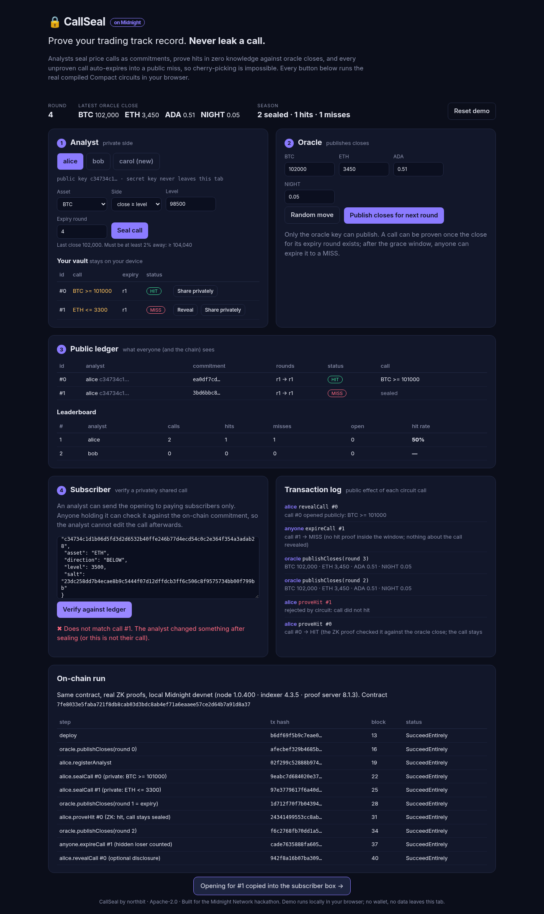

# CallSeal

**Prove your trading track record. Never leak a call.**

CallSeal is a zero-knowledge track record for trading analysts, built on [Midnight](https://midnight.network) in Compact.
An analyst seals a price call ("BTC closes ≥ 101,000 at round 5") as a commitment on-chain. After the expiry close is published, they prove *in zero knowledge* that the call hit, without ever revealing asset, side or level. Every call that is not proven in time becomes a public **MISS**, so hiding losers is impossible.

* Subscribers keep paying for the calls, because the calls never leak.
* The public gets an honest, verifiable hit rate instead of screenshots.
* The analyst can still reveal a call afterwards, or share the opening privately with paying subscribers, who can check it against the chain.

> Live demo (static, runs the real circuits in your browser): `npm run build:web && npm run serve` → http://127.0.0.1:5173
> Real network run with ZK proofs: [docs/onchain-proof.md](docs/onchain-proof.md)



## The problem

Paid trading signals are a large market (Telegram/Discord groups, newsletters, research desks), and it runs on trust:

* Track records are screenshots. Winners get posted, losers get deleted.
* Publishing calls openly to prove a record gives away the product to non-payers and front-runners.
* Existing "verified" platforms see every call, so the analyst has to trust the platform.

Midnight lets us separate the two things that always came bundled: **proving the record** (public) and **the calls themselves** (private).

## How it works

```
 analyst device (private)                        Midnight ledger (public)
 ─────────────────────────                       ───────────────────────────
 opening = {asset, side, level, salt}
 sealCall(expiry)  ── ZK proof ──────────────►   call #7: analyst pk, commitment,
   proves: level ≥ 2 % away from last close        sealed r3, expiry r5, SEALED
                                    oracle ──►   closes[r5] = [BTC, ETH, ADA, NIGHT]
 proveHit(7)       ── ZK proof ──────────────►   call #7: HIT  (stats.hits++)
   proves: opening matches commitment,
           close[asset] beats level
                     anyone after grace ─────►   expireCall(9): MISS (stats.misses++)
 revealCall(7)  (optional) ──────────────────►   revealed[7] = BTC ≥ 101,000
 share opening off-chain ──► subscriber checks commitmentOf(pk, opening) == ledger
```

### What is public and what is private

| | public (ledger) | private (analyst's device) |
|---|---|---|
| analyst | public key, calls / hits / misses | secret key |
| call | commitment, sealed round, expiry round, status | asset, side (≥ / ≤), level, salt |
| oracle | closes per round | oracle secret key |

What still leaks, by design: who made a call and when, its expiry round, and whether it hit. That is the track record. Asset, side and level stay hidden unless the analyst chooses `revealCall`.

### Anti-gaming rules enforced *inside the proof*

| attack | defence |
|---|---|
| hide losing calls | unproven calls expire to MISS; `expireCall` can be called by anyone |
| trivial calls ("BTC ≥ 1") to farm hits | `sealCall` proves the level is at least `minMoveBps` (2 %) away from the last close, in the called direction |
| edit a call after the fact | commitment = H(author, H(opening)); `proveHit` must open it exactly |
| copy someone else's commitment | the author is inside the commitment, so a copy can't be proven by anyone else |
| prove before the close exists / long after | proof only between expiry close and `expiry + graceRounds` |
| settle twice | status must be SEALED |
| hedging (seal ≥ and ≤ on the same asset) | the losing side still counts as a MISS, so hedging cannot lift the hit rate |

### Circuits

| circuit | who | what the chain learns |
|---|---|---|
| `constructor(oraclePk, minMoveBps, graceRounds)` | deployer | parameters |
| `publishCloses(prices[4])` | oracle only | closes for the round; round++ |
| `registerAnalyst()` | analyst | public key |
| `sealCall(expiryRound)` | analyst | commitment + rounds; proves non-triviality vs last close |
| `proveHit(id)` | call author | HIT; proves opening matches and beats the expiry close |
| `expireCall(id)` | anyone | MISS after the proof window |
| `revealCall(id)` | call author, after expiry | the opening (optional); a still-sealed call is scored as MISS on reveal |
| pure: `publicKey`, `commitmentOf`, `isHit`, `isNonTrivial` | off-chain | used by the UI and subscriber verification |

Contract: [`contract/src/callseal.compact`](contract/src/callseal.compact).

## Judge quickstart

Requirements: Node 22+, and for the network run, Docker and the Compact compiler 0.31.1 (language 0.23).

```bash
npm install
npm test                 # 27 tests: circuits, anti-gaming, privacy leak scans
npm run demo             # 2-minute terminal walkthrough of a full season
npm run build:web && npm run serve   # browser demo, http://127.0.0.1:5173
```

Recompile the contract (optional, the compiled output is committed):

```bash
npm run compact          # compactc 0.31.1, writes contract/managed/callseal (keys included)
```

### Full run on a local Midnight network (real proofs, real transactions)

```bash
npm run env:up           # node 1.0.400, indexer 4.3.5, proof server 8.1.3
#   (hosts without iptables/NAT: docker compose -f deploy/compose.host.yml up -d --wait)
npm run deploy:local     # deploys CallSeal and runs a whole season, writes deploy/runs/local.json
```

### Midnight testnet (preview)

```bash
MIDNIGHT_NETWORK=preview MIDNIGHT_SEED_FILE=/path/to/seed node deploy/address.mjs   # prints the address to fund
# fund it at the preview faucet, then:
MIDNIGHT_NETWORK=preview MIDNIGHT_SEED_FILE=/path/to/seed npm run deploy:preview
```

The script waits for NIGHT, registers it for DUST generation, waits for DUST, then runs the same season as on the local network. The seed is read from a file and never printed.

## Tests

`npm test` runs 27 tests in 8 suites against the compiled circuits (compact-runtime 0.16):

* oracle: only the oracle key can publish closes; constructor parameters
* registration: an analyst registers once, with zero stats
* sealing: only a commitment and rounds are stored; unregistered analyst, no close yet, past expiry, unknown asset and trivial calls (2 % boundary) are rejected
* proving: hit, miss, before the expiry close, after the window, non-author (even holding the opening), wrong opening, copied commitment, double settlement, unknown id
* expiry: anyone can expire an unproven call; a hit the analyst forgot to prove also becomes a miss
* selective disclosure: reveal after a hit keeps stats; revealing a still-sealed loser scores it as a miss; no reveal before expiry or of someone else's call
* privacy: the level and salt never appear in the public transcripts or the ledger; calls on different assets produce indistinguishable public records
* season: cherry-picking does not help across a full three-analyst season

## Repository layout

```
contract/src/callseal.compact   Compact contract
contract/managed/callseal/      compiler output (TS bindings, ZKIR, prover/verifier keys)
src/callseal.mjs                witnesses, private state, in-memory simulator (Node + browser)
src/cli.mjs                     terminal demo and subscriber verify command
test/                           node:test suite
web/                            static browser demo (esbuild → web/dist)
deploy/                         docker compose, network config, end-to-end network script
docs/                           architecture, on-chain proof, deck outline, video script, demo recording
```

## Limitations and roadmap

* **One trusted oracle.** The oracle signs closes with one key. Next: k-of-n oracle set, or closes from a Midnight price feed once available.
* **Identity.** Reputation attaches to a public key. Someone can run many keys and advertise only the best one. A season-level registry and minimum call counts make a fresh key visibly new.
* **Timing leaks.** Sealed and expiry rounds are public. Batching calls into fixed windows would hide timing too.
* **Four assets, round-based clock.** Enough for the demo; asset lists and per-asset rounds are a straightforward extension.
* **Subscriptions.** Paying for access to openings (e.g. in NIGHT/shielded tokens) is the next product step.

## AI disclosure

This project was built with substantial help from AI coding assistants: contract design, Compact and JavaScript code, tests, the web demo and documentation were drafted and iterated with AI tools, then run, tested and reviewed by the team. All test results and network runs in this repository come from actually executing the code.

## Credits and license

Built by **northbit** for the Midnight Network hackathon.
Local network compose file and the DUST registration flow are adapted from [midnightntwrk/midnight-examples](https://github.com/midnightntwrk) (Apache-2.0); see [NOTICE](NOTICE).

Licensed under the [Apache License 2.0](LICENSE).
